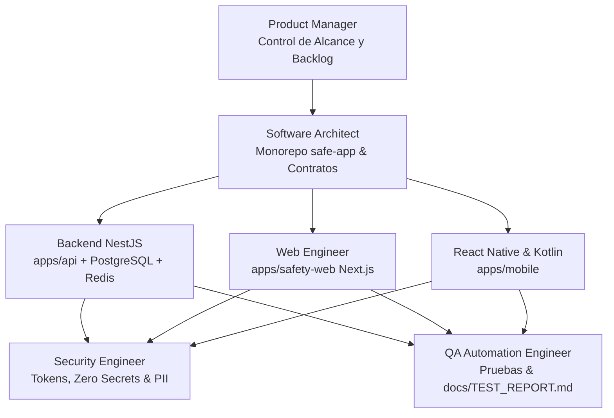

# MASTER_PLAN.md — Plan Maestro de Ingeniería de Atent

Este documento detalla la hoja de ruta integral, etapas de ejecución y criterios de transición para el desarrollo de la plataforma **Atent**.

---

## 1. Visión del Producto

**Atent** es un sistema integral de seguridad personal diseñado para ofrecer asistencia inmediata, seguimiento transparente de emergencias y comunicación coordinada con redes de apoyo y contactos de confianza. La plataforma combina una aplicación móvil reactiva (`apps/mobile`), una API robusta y altamente disponible (`apps/api`) y un visor web de seguridad seguro y accesible (`apps/safety-web`).

---

## 2. Fases de Ejecución

### Fase 0: Inicialización del Entorno y Gobernanza (Estado: COMPLETADA)
- Auditoría del entorno de desarrollo local (herramientas instaladas, SO, restricciones).
- Creación de artefactos de gobernanza (`AGENTS.md`, `docs/*`).
- Definición de normas de seguridad, no compromisos falsos de auxilio y política de cero secretos.

### Fase 1: Ingestión de Requisitos de Notion y Estructuración del Backlog (Estado: BLOQUEADA por BLK-001)
- Recepción de la documentación de Notion oficial del proyecto Atent.
- Mapeo directo y sin alteraciones de los MVPs, historias de usuario, IDs oficiales y criterios de aceptación en `docs/BACKLOG_EXECUTION.md`.
- Resolución y documentación de contradicciones o ambigüedades en `docs/DECISIONS.md`.

### Fase 2: Andamiaje Monorepo `safe-app` y Contratos Compartidos (Estado: LISTA PARA INICIAR)
- Configuración de monorepo con `npm workspaces`.
- Creación del paquete `packages/shared` con modelos de datos universales, DTOs y validadores.
- Configuración de pipelines de linting, formateo y TypeScript estricto.

### Fase 3: Backend Core y Persistencia (`apps/api`)
- Configuración base de NestJS modular.
- Modelado de PostgreSQL con TypeORM/Prisma/Kysely y migraciones deterministas.
- Integración de Redis para gestión de tokens temporales de emergencia y rate-limiting.
- Implementación de adaptadores de servicios externos (SMS, mapas) bajo modo Sandbox.
- Pruebas unitarias y de integración de API con supertest.

### Fase 4: Visor Web de Seguridad y Consola (`apps/safety-web`)
- Implementación en Next.js con diseño guiado por `frontend-design` y `brand-guidelines`.
- Flujo de acceso mediante enlaces temporales seguros con tokens de alta entropía.
- Visualización de coordenadas y estado de alerta en tiempo real.
- Pruebas E2E automatizadas con Playwright (`webapp-testing`).

### Fase 5: Aplicación Móvil (`apps/mobile`)
- Configuración de React Native con TypeScript.
- Integración con contratos de `packages/shared`.
- Módulo nativo Android (Kotlin) para foreground services de telemetría y eventos de hardware según el alcance del MVP.
- Manejo realista de estados de conectividad, batería y permisos de sistema.

### Fase 6: Pruebas Integradas E2E, Auditoría de Seguridad y Hardening
- Pruebas de extremo a extremo integrando móvil, API y visor web.
- Auditoría de seguridad (cero secretos, expiración de tokens, sanitización de logs, rate limiting).
- Validación de todos los criterios de aceptación contra el backlog original.
- Registro completo de evidencias en `docs/TEST_REPORT.md`.

---

## 3. Matriz de Roles y Responsabilidades

